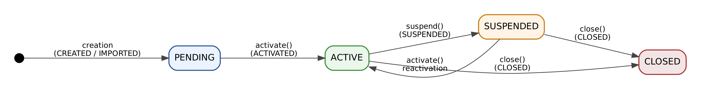

# UniAccounts — TP Design Patterns (Java)

Systeme de gestion des comptes etudiants.

| Travail | Patterns | Tag | Point d'entree |
|---|---|---|---|
| 1 — Noyau | Builder, Singleton, Prototype | `work1` | `Main` |
| 2 — Extension | State, Observer, Strategy, Composite, Adapter, Decorator, Facade | `work2` | `MainWork2` |

Le Travail 2 **reutilise** le Travail 1 sans le modifier (voir "Reutilisation").

## Structure
```
src/com/uniaccounts/
 ├── Main.java, MainWork2.java
 ├── model/ repository/ audit/ prototype/        # Travail 1 (inchange)
 ├── state/        AccountContext + 4 etats
 ├── observer/     AccountSubject + 3 observateurs
 ├── strategy/     CsvExport, JsonExport
 ├── composite/    OrgUnit, AccountLeaf
 ├── legacy/       LegacyStudentSystem (fourni, non modifie)
 ├── adapter/      LegacyStudentAdapter
 ├── decorator/    Library / Restaurant / Internet
 └── facade/       UniversityFacade
docs/   # RUN.md, diagrammes UML, captures, rapports
```

## Patterns -> classes
| Pattern | Classe(s) |
|---|---|
| Builder | `StudentAccount.Builder` |
| Singleton | `AccountRepository`, `AuditLogger` |
| Prototype | `AccountTemplate` |
| State | `AccountState`, `PendingState`, `ActiveState`, `SuspendedState`, `ClosedState`, `AccountContext` |
| Observer | `AccountSubject`, `AccountObserver`, `AuditObserver`, `EmailNotifier`, `AdminDashboard` |
| Strategy | `ExportStrategy`, `CsvExport`, `JsonExport`, `AccountExporter` |
| Composite | `OrgComponent`, `OrgUnit`, `AccountLeaf` |
| Adapter | `StudentSource`, `LegacyStudentAdapter` (+ `LegacyStudentSystem`) |
| Decorator | `AccountService`, `BasicAccountService`, `ServiceDecorator`, `LibraryService`, `RestaurantService`, `InternetService` |
| Facade | `UniversityFacade` |

## Reutilisation du Travail 1
`StudentAccount` est immuable : au lieu de le modifier, `AccountContext` (State) l'enveloppe et porte l'etat.
Le depot (`AccountRepository`) et le journal (`AuditLogger`) restent des Singletons utilises tels quels
par la facade et par `AuditObserver`. Aucun fichier du Travail 1 n'a ete modifie.

## Cycle de vie (State)


## Execution
Voir [docs/RUN.md](docs/RUN.md).

## Equipe
| Membre | Parties |
|---|---|
| Nini Yacine | (a completer) |
| Nasr Eddine Ben Mebarek | (a completer) |
| Rezki Mohamed Lamine | (a completer) |
